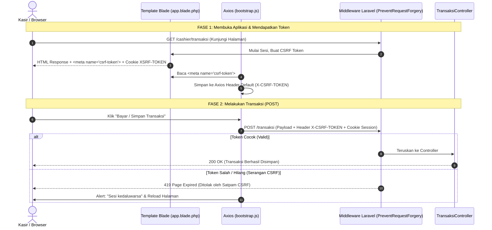

# MODUL PEMBELAJARAN CSRF PROTECTION
## Project: Sistem Kasir Ayam Jagal (Mata Kuliah Sistem Keamanan Data)

---

## DAFTAR ISI
1. [BAGIAN 1 — Pengenalan CSRF Protection](#bagian-1--pengenalan-csrf-protection)
2. [BAGIAN 2 — Dasar HTTP yang Perlu Dipahami](#bagian-2--dasar-http-yang-perlu-dipahami)
3. [BAGIAN 3 — Cara Kerja CSRF Token](#bagian-3--cara-kerja-csrf-token)
4. [BAGIAN 4 — Memahami Implementasi CSRF di Project](#bagian-4--memahami-implementasi-csrf-di-project)
5. [BAGIAN 5 — Simulasi Serangan dan Perlindungan](#bagian-5--simulasi-serangan-dan-perlindungan)
6. [BAGIAN 6 — Praktik Automated Testing](#bagian-6--praktik-automated-testing)
7. [BAGIAN 7 — Panduan Demonstrasi saat Presentasi](#bagian-7--panduan-demonstrasi-saat-presentasi)
8. [BAGIAN 8 — Bank Pertanyaan Dosen dan Jawabannya (35 Soal)](#bagian-8--bank-pertanyaan-dosen-dan-jawabannya)
9. [BAGIAN 9 — Rangkuman Kilat dan Skrip Presentasi](#bagian-9--rangkuman-kilat-dan-skrip-presentasi)
10. [BAGIAN 10 — Glosarium Istilah Teknis](#bagian-10--glosarium-istilah-teknis)

---

# BAGIAN 1 — PENGENALAN CSRF PROTECTION

### 1.1 Apa itu CSRF (Cross-Site Request Forgery)?
**CSRF (Cross-Site Request Forgery)** adalah jenis serangan siber di mana penyerang (*attacker*) memanfaatkan sesi login korban yang sah untuk mengirimkan perintah atau permintaan (*HTTP request*) ilegal ke sistem tanpa disadari oleh korban.

* **Analogi Kasir Ayam Jagal:**  
  Bayangkan Anda adalah kasir di toko potong ayam. Ada pelanggan langganan bernama Pak Budi. Karena Pak Budi sering bertransaksi, Anda sudah hafal wajah dan kartu tanda anggotanya.  
  Suatu ketika, seorang penjahat menyelipkan surat di dalam tas belanjaan Pak Budi tanpa sepengetahuan beliau. Surat itu bertuliskan: *"Kirim 100 kg paha ayam ke alamat X dan potong saldo deposit saya"*.  
  Ketika Pak Budi berdiri di depan meja kasir Anda, penjahat tersebut menarik surat tersebut dari tas Pak Budi dan menyodorkannya ke Anda. Karena Anda melihat Pak Budi ada di depan mata dan kartunya sah, Anda langsung memproses pesanan tersebut. Padahal, Pak Budi sama sekali tidak berniat membeli 100 kg paha ayam.

* **Kesimpulan:** CSRF bukan membobol kata sandi (*password cracking*), melainkan menyalahgunakan kepercayaan server terhadap browser korban yang sedang login.

---

### 1.2 Mengapa CSRF Termasuk Ancaman Berbahaya?
CSRF sangat berbahaya karena penyerang tidak perlu mencuri password pengguna. Penyerang hanya perlu memancing pengguna yang berwenang (misal Kasir atau Pemilik Toko) untuk mengunjungi situs yang sudah dipasangi skrip jahat ketika mereka masih login di aplikasi kasir.

* **Dampak pada Toko Ayam Jagal:**
  - Penjualan fiktif tercatat, merusak pembukuan kasir.
  - Rekening transfer bank toko diubah ke rekening penyerang.
  - Daftar menu ayam jagal tiba-tiba terhapus atau nonaktif, menghentikan operasional toko.

* **Kesimpulan:** CSRF mengeksploitasi hak istimewa pengguna yang sah tanpa perlu membongkar identitas otentikasi mereka secara langsung.

---

### 1.3 Bagaimana Cara Kerja Serangan CSRF?
Serangan ini memanfaatkan interaksi antar-situs (*cross-site*):
1. **Kasir Login:** Kasir login ke `http://kasir-ayam.com`. Server memberikan Session Cookie yang disimpan oleh browser kasir.
2. **Kunjungan Situs Jahat:** Kasir membuka tab baru dan membuka website lain yang mencurigakan (misalnya blog resep abal-abal atau mengklik link pancingan di WhatsApp: `http://resep-ayam-viral.com`).
3. **Pemicuan Permintaan:** Halaman `resep-ayam-viral.com` memiliki kode tersembunyi yang otomatis mengirimkan formulir ke `http://kasir-ayam.com/transaksi`.
4. **Eksekusi:** Browser kasir secara otomatis menyertakan cookie login kasir saat mengirimkan formulir tersebut ke server toko ayam.

```
+------------------+         (1) Login Berhasil (Simpan Cookie)         +--------------------+
|                  | <================================================= |                    |
|  Browser Kasir   |                                                    | Server Toko Ayam   |
| (Sedang Login)   | - - - - - (4) Kirim Request Palsu + Cookie - - - > | (Menerima Request) |
+------------------+                                                    +--------------------+
        ^                                                                          ^
        |                                                                          |
 (2) Buka Tab Baru                                                                 |
        |                                                                          |
+---------------------+                                                            |
| Website Penyerang   | ----------------- (3) Paksa Browser Kirim Form ------------+
| (resep-palsu.com)   |
+---------------------+
```

* **Kesimpulan:** Penyerang menjembatani perintah jahat melalui browser korban yang memiliki izin akses resmi.

---

### 1.4 Mengapa Browser Mengirim Cookie Secara Otomatis?
Secara standar (*default protocol* HTTP), browser dirancang untuk selalu melampirkan cookie yang cocok dengan domain tujuan setiap kali ada request ke domain tersebut. Ini dirancang demi kenyamanan pengguna agar pengguna tidak perlu login berulang-ulang setiap kali berpindah halaman. Namun, perilaku otomatis inilah yang menjadi celah yang dimanfaatkan CSRF.

* **Kesimpulan:** Sifat bawaan browser yang otomatis mengirimkan cookie ke domain asal adalah akar penyebab serangan CSRF.

---

### 1.5 Mengapa Pengguna yang Sedang Login Menjadi Sasaran Empuk?
Karena server mengenali pengguna semata-mata dari Session Cookie. Ketika request datang membawa Session Cookie yang sah, server menganggap *"Permintaan ini pasti berasal dari kasir saya yang terpercaya"*. Server tidak bisa membedakan apakah tombol diklik langsung oleh kasir di aplikasi atau dipicu secara gaib oleh script dari tab sebelah.

* **Kesimpulan:** Server tanpa proteksi CSRF mengalami kebutaan asal-usul perintah (*origin blindness*).

---

### 1.6 Apa itu CSRF Protection?
**CSRF Protection** adalah mekanisme keamanan yang memaksa browser membuktikan bahwa setiap permintaan modifikasi data benar-benar berasal dari interaksi sadar pengguna pada antarmuka aplikasi resmi, bukan dari website lain.

* **Analogi Satpam Kasir:**  
  Pemilik toko menugaskan satpam di depan meja kasir. Satpam menetapkan aturan: *"Membawa kartu member saja tidak cukup. Anda harus menunjukkan Tiket Stempel Rahasia harian yang hanya dibagikan di meja kasir toko ini"*. Situs jahat dari luar tidak bisa mengambil stempel tersebut karena adanya aturan pembatasan lintas situs (*Same-Origin Policy*).

* **Kesimpulan:** CSRF Protection memverifikasi otentisitas niat pengguna, bukan sekadar status loginnnya.

---

### 1.7 Apa itu CSRF Token?
**CSRF Token** adalah kode rahasia unik, acak (*random*), dan dinamis yang dibuat oleh server dan diberikan kepada klien (browser). Token ini wajib disertakan kembali ke server dalam setiap request POST, PUT, PATCH, atau DELETE.

* **Kesimpulan:** CSRF Token adalah kunci konfirmasi satu-sesi yang memastikan bahwa pengirim request memegang form asli dari aplikasi.

---

### 1.8 Mengapa Token Harus Sulit Ditebak?
Jika token pendek atau berurutan (misal: `token1`, `token2`), penyerang bisa memprediksi token tersebut dan menyematkannya pada script serangannya. Di Laravel, token CSRF menggunakan algoritma kriptografi string acak sepanjang 40 karakter alfanumerik yang dihasilkan oleh fungsi acak yang aman (*cryptographically secure pseudo-random number generator*).

* **Kesimpulan:** Acak dan sulit ditebak mencegah penyerang melakukan serangan tebakan (*brute-force* atau *prediction*).

---

### 1.9 Apa Perbedaan Session, Cookie, dan CSRF Token?

| Karakteristik | Session | Cookie | CSRF Token |
| :--- | :--- | :--- | :--- |
| **Lokasi Simpan** | Server (Database / File / Redis) | Browser (Penyimpanan Cookie Client) | Server (di dalam Session) & Client (HTML / Meta / Cookie JS) |
| **Pengiriman** | Tidak dikirim utuh; hanya Session ID yang dikirim | Dikirimkan **otomatis** oleh browser di setiap request | **Harus ditempel manual** oleh script/form pada Header atau Body |
| **Fungsi Utama** | Menyimpan status login & data pengguna | Mengikat browser dengan Session ID di server | Memvalidasi bahwa request berasal dari formulir resmi |
| **Analogi** | Buku Tamu Toko yang ada di laci meja kasir | KTP Kasir yang menempel di saku | Karcis Khusus bertanda tangan yang diambil dari meja kasir |

* **Kesimpulan:** Cookie adalah identitas, Session adalah buku catatan server, sedangkan CSRF Token adalah izin eksekusi tindakan.

---

### 1.10 Mengapa Aplikasi Kasir Sangat Membutuhkan Perlindungan Ini?
Aplikasi kasir ayam jagal melibatkan perputaran uang tunai, stok fisik ayam, dan rekening bank:
1. **Proteksi Saldo:** Mencegah pencatatan pelunasan palsu.
2. **Integritas Inventaris:** Mencegah perubahan data master harga menu ayam dan pengurangan stok sepihak.
3. **Keamanan Finansial:** Mencegah rekening bank tujuan transfer diganti oleh pihak ketiga.

* **Kesimpulan:** Dalam sistem finansial dan kasir, integritas data sama pentingnya dengan kerahasiaan data.

---

# BAGIAN 2 — DASAR HTTP YANG PERLU DIPAHAMI

### 2.1 HTTP Methods dalam Sistem Kasir Ayam Jagal

| HTTP Method | Karakteristik | Fungsi | Contoh di Route Sistem Kasir Ayam Jagal |
| :--- | :--- | :--- | :--- |
| **GET** | *Safe* & *Idempotent* | Membaca / mengambil data | `GET /menu` (Melihat daftar ayam potong & bumbu) |
| **POST** | *Unsafe* & *Non-Idempotent* | Menambah / membuat data baru | `POST /transaksi` (Kasir menyimpan transaksi penjualan) |
| **PUT** | *Unsafe* & *Idempotent* | Mengganti seluruh data | `PUT /menu/{menu}` (Admin mengubah seluruh data menu) |
| **PATCH** | *Unsafe* & *Non-Idempotent* | Mengubah sebagian atribut data | `PATCH /menu/{menu}/status` (Mengubah status aktif/nonaktif menu) |
| **DELETE** | *Unsafe* & *Idempotent* | Menghapus data dari sistem | `DELETE /rekening-bank/{rekeningBank}` (Menghapus akun rekening) |

---

### 2.2 Komponen Dasar Pesan HTTP
1. **HTTP Request:** Pesan yang dikirim oleh browser kasir ke server Laravel untuk meminta sesuatu (halaman web, aksi simpan, dll.).
2. **HTTP Response:** Balasan dari server Laravel kembali ke browser kasir (berisi tampilan HTML, data JSON, atau pesan kesalahan).
3. **HTTP Header:** Informasi meta/amplop pengiriman. Contoh header:
   - `Content-Type: application/json` (Memberitahu isi data berformat JSON).
   - `X-CSRF-TOKEN: abc123xyz...` (Menyematkan token keamanan).
   - `Cookie: laravel_session=...` (Menyematkan sesi login).
4. **HTTP Body:** Isi muatan data yang dikirimkan. Misalnya saat kasir menyimpan transaksi:
   ```json
   {
     "metode_pembayaran": "tunai",
     "nominal_bayar": 50000,
     "items": [{"menu_id": 1, "jumlah": 2}]
   }
   ```
5. **HTTP Status Code:** Kode status 3 digit yang menandakan hasil pemrosesan:
   - `200 OK`: Permintaan berhasil diproses.
   - `302 Found`: Pengalihan (*redirect*) ke URL lain.
   - `401 Unauthorized`: Belum login (tidak punya kredensial).
   - `403 Forbidden`: Sudah login, tapi tidak punya hak akses (misal kasir mencoba membuka menu admin).
   - `419 Page Expired (Laravel CSRF)`: Token CSRF tidak ada, tidak cocok, atau sudah kedaluwarsa.
   - `422 Unprocessable Entity`: Validasi form gagal (misal nominal bayar kurang).
   - `500 Internal Server Error`: Ada error atau bug pada script backend.

---

### 2.3 Safe Method vs Idempotent: Jangan Tertukar!

* **Safe Method (Metode Aman):**
  Metode HTTP yang menurut spesifikasi **tidak boleh mengubah status (*state*) data di server**.
  - Contoh: `GET` dan `HEAD`.
  - Mengakses `GET /menu` sepuluh kali tidak akan mengubah stok ayam atau mengurangi saldo kasir. Oleh karena itu, metode *Safe* **tidak memerlukan proteksi CSRF**.

* **Idempotent (Dapat Diulang dengan Hasil Sama):**
  Metode HTTP yang jika dijalankan satu kali atau berkali-kali secara berurutan dengan parameter yang sama, **akan menghasilkan kondisi akhir data yang sama di server**.
  - Contoh: `PUT` dan `DELETE`.
  - Jika Anda mengirim `DELETE /rekening-bank/5` sekali, rekening terhapus. Jika script jahat mengirimkannya lagi 5 kali, hasilnya tetap sama: rekening nomor 5 sudah tidak ada.
  - Walaupun `PUT` dan `DELETE` bersifat *idempotent*, keduanya **bukan** *safe method* karena mengubah data! Oleh sebab itu, `PUT`, `PATCH`, `DELETE`, dan `POST` **tetap wajib dilindungi CSRF**.

* **Mengapa GET Tidak Boleh Mengubah Data?**
  Jika developer ceroboh membuat route seperti `GET /rekening-bank/delete?id=5`, maka penyerang cukup menyisipkan tag gambar di forum luar:
  ``.
  Ketika browser memuat gambar, data rekening terhapus otomatis tanpa perlu form! Itulah sebabnya operasi manipulasi data wajib menggunakan method non-GET (POST/PUT/DELETE) yang diproteksi CSRF.

---

# BAGIAN 3 — CARA KERJA CSRF TOKEN

### 3.1 Alur Siklus Hidup CSRF dari Awal Hingga Akhir
Berikut tahapan lengkap dari saat kasir datang ke toko hingga transaksi tersimpan:

1. **Kasir Mengakses Halaman:** Kasir membuka `http://kasir-ayam.com/login` di browser.
2. **Inisialisasi Session:** Server Laravel menerima request. Jika belum ada session, middleware `StartSession` membuat session baru di server.
3. **Penerbitan CSRF Token:** Laravel membuat string acak 40 karakter (CSRF Token) dan mengaitkannya ke session tersebut.
4. **Penyaluran Token ke Browser:** Laravel mengirim response dengan menyertakan token melalui dua jalur:
   - **HTML Meta Tag:** `<meta name="csrf-token" content="...">` di template Blade.
   - **Cookie `XSRF-TOKEN`:** Cookie khusus yang tidak berstatus *HttpOnly* agar bisa dibaca oleh JavaScript klien.
5. **Penyimpanan di Browser:** Browser menyimpan cookie sesi dan merender meta tag ke dalam DOM.
6. **Frontend Mengambil Token:** Berkas `bootstrap.js` membaca isi konten dari `<meta name="csrf-token">` dan memasukkannya ke header default Axios: `X-CSRF-TOKEN`.
7. **Kasir Menginput Data:** Kasir memilih menu pesanan ayam, memasukkan uang bayar, dan menekan tombol **"Simpan Transaksi"**.
8. **Pengiriman Request:** Axios mengirim request HTTP `POST /transaksi` dengan menyertakan header `X-CSRF-TOKEN` beserta cookie session.
9. **Validasi Middleware:** Middleware `PreventRequestForgery` di Laravel mencegat request sebelum sampai ke `TransaksiController`:
   - Mengambil token dari header request (`X-CSRF-TOKEN`).
   - Mengambil token asli yang tersimpan di server session.
   - Membandingkannya menggunakan fungsi `hash_equals()`.
10. **Keputusan Server:**
    - Jika cocok: Request dilanjutkan ke `TransaksiController@store` (data tersimpan, response 200/201).
    - Jika tidak cocok / tidak ada: Request langsung dibatalkan, server merespons dengan **HTTP 419 Page Expired**.

---

### 3.2 Diagram Alur Mermaid



---

### 3.3 Bedah Perbedaan Istilah Token & Mekanismenya

| Nama Istilah | Jenis Objek | Siapa yang Mengisi? | Digunakan di Project Kasir? | Keterangan & Peran |
| :--- | :--- | :--- | :--- | :--- |
| `laravel_session` | HTTP Cookie | Server Laravel | **YA (Wajib)** | Cookie penanda identitas login kasir. Berstatus `HttpOnly` agar aman dari pencurian script XSS. |
| `XSRF-TOKEN` | HTTP Cookie | Server Laravel | **YA (Otomatis)** | Cookie berisi token CSRF yang dapat dibaca JavaScript. Axios secara otomatis mencari cookie ini jika header manual tidak disetel. |
| `<meta name="csrf-token">` | HTML Tag | Blade View | **YA (Aktif)** | Elemen HTML di `<head>` untuk menyimpan token agar script frontend dapat membacanya langsung dari dokumen. |
| `X-CSRF-TOKEN` | HTTP Header | JavaScript (Axios) | **YA (Aktif Utama)** | Header HTTP kustom yang dikirimkan oleh Axios di `bootstrap.js` setelah membaca isi dari meta tag. |
| `X-XSRF-TOKEN` | HTTP Header | JavaScript (Axios) | Alternatif Standar | Header yang biasanya diisi otomatis oleh Axios dari cookie `XSRF-TOKEN` terenkripsi. Di project ini, kita melengkapinya dengan `X-CSRF-TOKEN`. |
| `_token` | Form Input / JSON Body | HTML Form / Payload | Alternatif Form Tradisional | Parameter di dalam body request. Biasa digunakan pada form HTML murni (`<input type="hidden" name="_token">`). |
| `withCredentials` | Properti Boolean Axios | Pengembang JS | **YA (Aktif)** | Bernilai `true` agar Axios selalu menyertakan cookie (termasuk session cookie) pada request lintas origin (*cross-site credentials*). |

---

# BAGIAN 4 — MEMAHAMI IMPLEMENTASI CSRF DI PROJECT

Audit ini berbasiskan berkas asli pada branch `skd-csrf-dito`.

---

### 4.1 Berkas A: `resources/views/app.blade.php`

#### Fungsi File
Ini adalah berkas template utama (*master layout*) Laravel yang membungkus aplikasi Single Page Application (SPA) berbasis Inertia.js dan Vue 3.

#### Masalah Sebelum Perubahan
Sebelumnya, template ini tidak memiliki tag `<meta name="csrf-token">`. Akibatnya, JavaScript tidak memiliki cara standar untuk membaca CSRF Token langsung dari halaman HTML.

#### Kode Aktual yang Dipasang
```html
<!DOCTYPE html>
<html lang="{{ str_replace('_', '-', app()->getLocale()) }}">
    <head>
        <meta charset="utf-8">
        <meta name="viewport" content="width=device-width, initial-scale=1">
        <meta name="csrf-token" content="{{ csrf_token() }}">

        <title inertia>{{ config('app.name', 'Laravel') }}</title>
```

#### Penjelasan Baris demi Baris
- **Baris 6:** `<meta name="csrf-token" content="{{ csrf_token() }}">`
  - `<meta>`: Elemen HTML penampung data metadata yang tidak tampil di layar pengguna.
  - `name="csrf-token"`: Penanda unik agar elemen ini mudah dicari oleh JavaScript melalui perintah `document.querySelector('meta[name="csrf-token"]')`.
  - `content="{{ csrf_token() }}"`: Fungsi bawaan Laravel `csrf_token()` yang mengambil string token acak dari session aktif server dan menuliskannya ke dalam atribut `content`.

#### Kontribusi Keamanan & Dampak Jika Dihapus
- **Kontribusi:** Berperan sebagai jembatan pembagi token dari server ke client tanpa harus membongkar cookie HTTP.
- **Jika Tidak Ada:** Frontend JavaScript kesulitan mendapatkan nilai token murni, sehingga Axios harus bergantung penuh pada pembacaan cookie manual yang rentan terhadap restriksi domain tertentu.

---

### 4.2 Berkas B: `resources/js/bootstrap.js`

#### Fungsi File
Berkas inisialisasi JavaScript global yang mengatur konfigurasi pustaka HTTP client (**Axios**).

#### Masalah Sebelum Perubahan
Sebelumnya, Axios hanya memiliki konfigurasi dasar `X-Requested-With: XMLHttpRequest`. Axios belum mengambil CSRF Token dari meta tag, belum mengaktifkan `withCredentials`, dan belum memiliki penanganan jika sewaktu-waktu sesi kasir kedaluwarsa (HTTP 419).

#### Kode Aktual yang Dipasang
```javascript
import axios from 'axios';
window.axios = axios;

window.axios.defaults.headers.common['X-Requested-With'] = 'XMLHttpRequest';
window.axios.defaults.withCredentials = true;

const csrfToken = document.head?.querySelector('meta[name="csrf-token"]');
if (csrfToken) {
    window.axios.defaults.headers.common['X-CSRF-TOKEN'] = csrfToken.content;
}

window.axios.interceptors.response.use(
    (response) => response,
    (error) => {
        if (error.response && error.response.status === 419) {
            alert('Sesi Anda telah kedaluwarsa atau token CSRF tidak valid. Halaman akan dimuat ulang.');
            window.location.reload();
        }
        return Promise.reject(error);
    }
);
```

#### Penjelasan Baris demi Baris
- **Baris 1–2:** Mengimpor pustaka Axios dan menaruhnya di objek global `window` agar bisa diakses oleh composable transaksi kasir (`useCashierTransaction.js`).
- **Baris 4:** Menandai request sebagai panggilan AJAX (`XMLHttpRequest`).
- **Baris 5:** `window.axios.defaults.withCredentials = true;`  
  Menginstruksikan Axios untuk selalu menyertakan kredensial (seperti cookie session) pada setiap request yang dikirimkan.
- **Baris 7–10:**  
  Mencari elemen `<meta name="csrf-token">` di `<head>`. Jika ditemukan, nilainya dimasukkan ke header default Axios dengan nama `X-CSRF-TOKEN`. Semua request POST/PUT/DELETE berikutnya otomatis membawa header ini.
- **Baris 12–21 (Axios Interceptor):**
  - `window.axios.interceptors.response.use(...)`: "Satpam" penerima respon server sebelum diserahkan ke komponen Vue.
  - `if (error.response && error.response.status === 419)`: Mengecek apakah server menolak request karena token habis/salah (Kode 419).
  - `alert(...)`: Memberi tahu kasir dengan bahasa yang ramah bahwa sesi habis.
  - `window.location.reload()`: Me-refresh browser. Saat refresh, browser akan meminta halaman baru, Laravel membuat sesi & CSRF token yang segar, sehingga kasir dapat bertransaksi kembali tanpa macet.
  - `return Promise.reject(error)`: Meneruskan pesan error jika bukan kode 419.

#### Kontribusi Keamanan & Dampak Jika Dihapus
- **Kontribusi:** Mengotomatiskan pengiriman token ke setiap request API dan menyediakan mekanisme pemulihan otomatis saat token kedaluwarsa.
- **Jika Tidak Ada:** Kasir akan mengalami error misterius ketika kasir meninggalkan aplikasi sejenak; tombol simpan transaksi tidak bereaksi dan hanya menampilkan pesan "Gagal menyimpan".

---

### 4.3 Berkas C: `app/Http/Middleware/HandleInertiaRequests.php`

#### Fungsi File
Middleware penghubung Laravel dengan Inertia.js untuk membagikan data dari backend ke seluruh halaman Vue secara global (*Shared Props*).

#### Kode Aktual yang Dipasang
```php
    public function share(Request $request): array
    {
        return [
            ...parent::share($request),
            'auth' => [
                'user' => $request->user(),
            ],
            'csrf_token' => csrf_token(),
        ];
    }
```

#### Penjelasan Baris demi Baris
- **Baris 37:** `'csrf_token' => csrf_token(),`  
  Memasukkan nilai token aktif ke dalam props Inertia. Di komponen Vue mana pun, kasir/pengembang dapat mengakses token ini melalui:
  ```javascript
  import { usePage } from '@inertiajs/vue3';
  const token = usePage().props.csrf_token;
  ```

#### Apakah Benar-Benar Diperlukan? (Catatan Kritis Evaluasi)
Secara teknis, karena kita sudah memasang token di meta tag `app.blade.php` dan Axios sudah membacanya secara global, pembagian token via Inertia ini bersifat **pelengkap redundan (*secondary fallback*)**. Ini sangat berguna jika di kemudian hari ada form yang dikirim menggunakan Inertia Form Helper (`useForm`) murni tanpa Axios biasa, sehingga komponen tetap memiliki akses langsung ke token.

---

### 4.4 Berkas D: `tests/Feature/CsrfProtectionTest.php`

#### Fungsi File
Berkas pengujian otomatis (*automated test*) untuk membuktikan secara empiris dan matematis bahwa seluruh endpoint manipulasi data di aplikasi ini terlindungi dari CSRF.

#### Cuplikan Kode Penting (Kunci Keberhasilan Test)
```php
    protected function setUp(): void
    {
        parent::setUp();

        // Enforce CSRF verification by disabling unit test bypass
        $this->app->instance(
            PreventRequestForgery::class,
            new class($this->app, $this->app['encrypter']) extends PreventRequestForgery {
                protected function runningUnitTests(): bool
                {
                    return false;
                }
            }
        );
    }
```

#### Mengapa Kode di Atas Sangat Penting?
Secara bawaan (*default*), framework Laravel mematikan pemeriksaan CSRF selama pengujian unit/fitur agar developer mudah menguji fungsionalitas lain.
Jika potongan kode di atas tidak ada, maka **pengujian CSRF akan menghasilkan kesimpulan palsu (*false positive*)**!
Dengan menimpa method `runningUnitTests()` agar mengembalikan `false`, kita memaksa middleware CSRF Laravel untuk tetap menyala dan memeriksa setiap token layaknya di browser nyata.

---

### 4.5 Middleware CSRF Bawaan Laravel 11 (`PreventRequestForgery`)

Banyak mahasiswa mengira middleware CSRF Laravel bernama `VerifyCsrfToken`. **Di Laravel 11, middleware tersebut telah diperbarui dan dinamakan `PreventRequestForgery`.**

#### Lokasi & Pendaftaran
Di Laravel 11, middleware tidak lagi didaftarkan di `app/Http/Kernel.php` (karena berkas tersebut sudah ditiadakan). Konfigurasi aplikasi dipusatkan pada `bootstrap/app.php`:
```php
return Application::configure(basePath: dirname(__DIR__))
    ->withRouting(
        web: __DIR__.'/../routes/web.php',
        commands: __DIR__.'/../routes/console.php',
        health: '/up',
    )
    ->withMiddleware(function (Middleware $middleware): void {
        $middleware->web(append: [
            \App\Http\Middleware\HandleInertiaRequests::class,
            \Illuminate\Http\Middleware\AddLinkHeadersForPreloadedAssets::class,
        ]);
        // ...
    })
```
Secara otomatis, grup route `web` memasukkan middleware:
`Illuminate\Foundation\Http\Middleware\PreventRequestForgery::class`.

#### Cara Kerja Validasi di Dalam Laravel
Middleware ini mengecek request dengan urutan logika:
1. Apakah method-nya aman? (`GET`, `HEAD`, `OPTIONS`). Jika ya, lolos.
2. Apakah request berasal dari origin yang sama? (`Sec-Fetch-Site: same-origin`).
3. Apakah token cocok? Middleware membaca input `_token`, atau header `X-CSRF-TOKEN`, atau mendekripsi cookie `X-XSRF-TOKEN`.
4. Nilai token dibandingkan dengan `session()->token()` menggunakan `hash_equals()`.
5. Jika gagal, Laravel melemparkan `TokenMismatchException` yang diubah menjadi respon **HTTP 419 Page Expired**.

---

# BAGIAN 5 — SIMULASI SERANGAN DAN PERLINDUNGAN

Mari kita pelajari tiga skenario nyata yang membuktikan apakah satpam CSRF bekerja dengan benar:

### Skenario 1: Penyerang Mengirim Request Tanpa Token
* **Kondisi:** Situs phishing mencoba memicu order fiktif dengan mengirimkan request langsung ke endpoint kasir:
  `POST /transaksi` membawa cookie kasir, tetapi **tanpa** CSRF Token.
* **Proses di Server:** Middleware `PreventRequestForgery` memeriksa header dan payload. Nilai token bernilai `null`.
* **Hasil:** Request ditolak mentah-mentah! Server mengembalikan respon:
  `HTTP 419 Page Expired - CSRF token mismatch`. Database transaksi tetap bersih.

---

### Skenario 2: Penyerang Mengirim Request dengan Token Palsu / Sembarang
* **Kondisi:** Penyerang mengetahui sistem menggunakan CSRF Token, lalu mencoba menebak atau memasukkan token palsu:
  Header: `X-CSRF-TOKEN: token-abal-abal-12345`.
* **Proses di Server:** Middleware membandingkan token palsu tersebut dengan token yang ada di server session kasir.
  `hash_equals("token-resmi-server", "token-abal-abal-12345") === false`.
* **Hasil:** Validasi gagal! Server mengembalikan respon:
  `HTTP 419 Page Expired`.

---

### Skenario 3: Kasir Bertransaksi Menggunakan Aplikasi Resmi (Token Benar)
* **Kondisi:** Kasir menekan tombol "Bayar" di aplikasi kasir resmi toko ayam.
* **Proses di Server:** Axios otomatis membaca meta tag dan mengirimkan header:
  `X-CSRF-TOKEN: 40_karakter_token_resmi`.
  Middleware membandingkannya:
  `hash_equals("40_karakter_token_resmi", "40_karakter_token_resmi") === true`.
* **Hasil:** Permintaan lolos satpam CSRF! Permintaan diteruskan ke `TransaksiController`, transaksi berhasil disimpan ke database, dan bukti struk tercetak (HTTP 200 OK).

---

### Diagram Perbandingan 3 Skenario

```
[ Request Lintas Situs Tanpa Token ] -----> ( Satpam CSRF: "Mana Karcis Token Anda?" ) -----> [ DITOLAK (HTTP 419) ]
[ Request dengan Token Palsu/Tebakan ] --> ( Satpam CSRF: "Karcis Palsu!" ) ---------------> [ DITOLAK (HTTP 419) ]
[ Request Resmi via Aplikasi Kasir ] ----> ( Satpam CSRF: "Karcis Valid, Silakan Masuk" ) --> [ DITERIMA (HTTP 200) ]
```

---

# BAGIAN 6 — PRAKTIK AUTOMATED TESTING

### 6.1 Tabel Audit 11 Skenario Pengujian pada `CsrfProtectionTest.php`

| No | Nama Method Test | Tujuan Pengujian | Parameter Request | Hasil yang Diharapkan |
| :---: | :--- | :--- | :--- | :--- |
| **1** | `test_get_request_is_allowed_without_csrf_token` | Memastikan metode baca (GET) tidak memerlukan token. | `GET /` tanpa token | Status `200 OK` |
| **2** | `test_post_transaksi_without_csrf_token_is_rejected_with_419` | Membuktikan transaksi penjualan ayam tanpa token ditolak. | `POST /transaksi` tanpa token | Status `419 Page Expired` |
| **3** | `test_post_transaksi_with_invalid_csrf_token_is_rejected_with_419` | Membuktikan token palsu dari penyerang ditolak. | `POST /transaksi` + Token Salah | Status `419 Page Expired` |
| **4** | `test_post_transaksi_with_valid_csrf_token_in_header_passes_csrf_check` | Membuktikan request resmi kasir via Header berhasil lolos. | `POST /transaksi` + Header `X-CSRF-TOKEN` valid | Status `!= 419` (Lolos satpam CSRF) |
| **5** | `test_post_transaksi_with_valid_csrf_token_in_body_passes_csrf_check` | Membuktikan request resmi via Body Form berhasil lolos. | `POST /transaksi` + Body `_token` valid | Status `!= 419` (Lolos satpam CSRF) |
| **6** | `test_admin_post_menu_without_csrf_token_is_rejected` | Membuktikan penambahan menu ayam tanpa token ditolak. | `POST /menu` tanpa token | Status `419 Page Expired` |
| **7** | `test_admin_put_menu_without_csrf_token_is_rejected` | Membuktikan pengubahan menu ayam (PUT) tanpa token ditolak. | `PUT /menu/{id}` tanpa token | Status `419 Page Expired` |
| **8** | `test_admin_delete_menu_without_csrf_token_is_rejected` | Membuktikan penghapusan menu ayam (DELETE) tanpa token ditolak. | `DELETE /menu/{id}` tanpa token | Status `419 Page Expired` |
| **9** | `test_admin_patch_menu_status_without_csrf_token_is_rejected` | Membuktikan pengubahan status menu (PATCH) tanpa token ditolak. | `PATCH /menu/{id}/status` tanpa token | Status `419 Page Expired` |
| **10** | `test_admin_rekening_bank_without_csrf_token_is_rejected` | Membuktikan pengubahan rekening bank toko tanpa token ditolak. | `POST /rekening-bank` tanpa token | Status `419 Page Expired` |
| **11** | `test_logout_endpoint_without_csrf_token_is_rejected` | Membuktikan pemaksaan logout sepihak (*forced logout*) ditolak. | `POST /logout` tanpa token | Status `419 Page Expired` |

---

### 6.2 Panduan Menjalankan Pengujian dari Terminal (Linux / WSL / PowerShell)

Buka terminal Anda, lalu jalankan langkah-langkah berikut:

#### 1. Masuk ke Direktori Project
```bash
cd /d/GITHUB/skd-sistem-kasir-ayam-jagal
# atau jika di Linux/WSL:
# cd /mnt/d/GITHUB/skd-sistem-kasir-ayam-jagal
```

#### 2. Pastikan Berada di Branch yang Benar
```bash
git branch --show-current
```
*Pastikan terminal menampilkan:* `skd-csrf-dito`.

#### 3. Jalankan Pengujian Khusus CSRF Protection
```bash
php vendor/bin/phpunit tests/Feature/CsrfProtectionTest.php
```
*Atau menggunakan artisan:*
```bash
php artisan test tests/Feature/CsrfProtectionTest.php
```

#### 4. Cara Membaca Hasil PASS
Jika semua skenario sukses, terminal akan menampilkan warna hijau:
```text
PASS  Tests\Feature\CsrfProtectionTest
✓ get request is allowed without csrf token
✓ post transaksi without csrf token is rejected with 419
✓ post transaksi with invalid csrf token is rejected with 419
✓ post transaksi with valid csrf token in header passes csrf check
✓ post transaksi with valid csrf token in body passes csrf check
✓ admin post menu without csrf token is rejected
✓ admin put menu without csrf token is rejected
✓ admin delete menu without csrf token is rejected
✓ admin patch menu status without csrf token is rejected
✓ admin rekening bank without csrf token is rejected
✓ logout endpoint without csrf token is rejected

Tests:    11 passed (11 assertions)
Duration: 0.72s
```
**Arti Hasil:** Seluruh pintu masuk manipulasi data terbukti terkunci rapat oleh CSRF Protection.

#### 5. Cara Membaca Hasil FAIL (Jika Ada Kegagalan)
Jika ada celah keamanan atau token bocor, terminal akan menampilkan warna merah:
```text
FAIL  Tests\Feature\CsrfProtectionTest
✗ post transaksi without csrf token is rejected with 419
Expected response status code [419] but received 200.
```
**Arti Kegagalan:** Sistem menerima request yang tidak berizin (terdapat celah keamanan CSRF).

#### 6. Menjalankan Seluruh Pengujian Aplikasi
Untuk membuktikan bahwa penambahan fitur CSRF tidak merusak fitur kasir yang sudah ada sebelumnya:
```bash
php vendor/bin/phpunit
```
*Hasil:* **65 tests passed, 161 assertions passed (100% Green).**

---

# BAGIAN 7 — PANDUAN DEMONSTRASI SAAT PRESENTASI

Berikut panduan langkah demi langkah saat Anda berdiri di depan proyektor:

### Langkah 1: Jalankan Server Lokal
Di terminal 1:
```bash
php artisan serve
```
Aplikasi aktif di `http://127.0.0.1:8000`.

---

### Langkah 2: Buka Browser & Periksa Meta Tag (DevTools)
1. Buka Google Chrome / Edge, kunjungi `http://127.0.0.1:8000`.
2. Tekan tombol `F12` untuk membuka **Developer Tools**, pilih tab **Elements** (Elemen).
3. Buka tag `<head>`, tunjukkan ke dosen:
   ```html
   <meta name="csrf-token" content="jH8s...40_karakter_token...">
   ```
4. *Jelaskan ke Dosen:* *"Bapak/Ibu, ini adalah token acak yang diterbitkan server saat halaman kasir dimuat. Token ini akan diambil otomatis oleh JavaScript kita."*

---

### Langkah 3: Tunjukkan Token pada Header Axios (Tab Network)
1. Pindah ke tab **Network** di DevTools.
2. Lakukan login sebagai Kasir.
3. Klik salah satu menu ayam, lalu simpan pesanan.
4. Klik request `transaksi` di tab Network, buka bagian **Request Headers**.
5. Tunjukkan baris:
   ```http
   X-CSRF-TOKEN: jH8s...40_karakter_token...
   ```
6. *Jelaskan ke Dosen:* *"Setiap kali kasir mengklik tombol bayar, Axios di berkas bootstrap.js secara otomatis menyematkan header X-CSRF-TOKEN ini."*

---

### Langkah 4: Demonstrasi Serangan Langsung Menggunakan Console Browser
Buka tab **Console** di DevTools (kita gunakan fungsi `fetch` murni bawaan browser yang tidak memiliki konfigurasi Axios kita untuk mensimulasikan script hacker):

#### A. Uji Coba Serangan 1: Kirim Request Tanpa Token
Ketik di Console lalu tekan Enter:
```javascript
fetch('/transaksi', {
    method: 'POST',
    headers: {
        'Content-Type': 'application/json',
        'Accept': 'application/json'
    },
    body: JSON.stringify({ nominal_bayar: 100000 })
}).then(r => console.log("Status Respon:", r.status));
```
*Hasil di Layar:* `Status Respon: 419`.  
*Komentar Anda:* *"Terlihat statusnya 419 Page Expired. Serangan tanpa token berhasil digagalkan oleh middleware Laravel."*

#### B. Uji Coba Serangan 2: Kirim Request dengan Token Palsu
Ketik di Console lalu tekan Enter:
```javascript
fetch('/transaksi', {
    method: 'POST',
    headers: {
        'Content-Type': 'application/json',
        'Accept': 'application/json',
        'X-CSRF-TOKEN': 'TOKEN_PALSU_DARI_HACKER'
    },
    body: JSON.stringify({ nominal_bayar: 100000 })
}).then(r => console.log("Status Respon:", r.status));
```
*Hasil di Layar:* `Status Respon: 419`.  
*Komentar Anda:* *"Penyerang mencoba menebak token, namun server memvalidasi kecocokannya dengan session dan menolaknya."*

#### C. Uji Coba 3: Kirim Request dengan Token Resmi Aplikasi
Ketik di Console lalu tekan Enter:
```javascript
const tokenResmi = document.querySelector('meta[name="csrf-token"]').getAttribute('content');

fetch('/transaksi', {
    method: 'POST',
    headers: {
        'Content-Type': 'application/json',
        'Accept': 'application/json',
        'X-CSRF-TOKEN': tokenResmi
    },
    body: JSON.stringify({ nominal_bayar: 100000 })
}).then(r => console.log("Status Respon:", r.status));
```
*Hasil di Layar:* `Status Respon: 422` (atau 200).  
*Komentar Anda:* *"Perhatikan statusnya berubah menjadi 422 Unprocessable Entity (validasi form data ayam kurang lengkap) dan BUKAN lagi 419. Ini membuktikan bahwa satpam CSRF berhasil dilewati karena token valid!"*

---

# BAGIAN 8 — BANK PERTANYAAN DOSEN DAN JAWABANNYA

### Kelompok 1: Pertanyaan Dasar
1. **Dosen:** *Apa itu CSRF secara singkat?*  
   **Jawaban:** Serangan di mana website pihak ketiga memanipulasi browser korban yang sedang login untuk mengirimkan perintah ilegal ke server target tanpa disadari korban.
2. **Dosen:** *Mengapa dinamakan Cross-Site?*  
   **Jawaban:** Karena permintaan eksekusi dipicu dari satu situs (*site A*) ke situs lain yang menjadi target (*site B*).
3. **Dosen:** *Apakah CSRF mencuri kata sandi pengguna?*  
   **Jawaban:** Tidak. CSRF tidak mencuri kredensial, melainkan menyalahgunakan sesi login yang sudah aktif di browser korban.
4. **Dosen:** *Apa akibatnya jika sistem kasir ayam jagal terkena CSRF?*  
   **Jawaban:** Penyerang dapat membuat transaksi fiktif, mengubah rekening penerima transfer toko, atau menghapus master data menu ayam.
5. **Dosen:** *Apakah website yang menggunakan HTTPS otomatis kebal CSRF?*  
   **Jawaban:** Tidak. HTTPS hanya mengenkripsi jalur komunikasi data dari penyadapan (*sniffing*), tetapi tidak memverifikasi apakah request dipicu secara sadar oleh pengguna atau oleh skrip pihak ketiga.

---

### Kelompok 2: Pertanyaan Seputar CSRF Token
6. **Dosen:** *Apa fungsi utama dari CSRF Token?*  
   **Jawaban:** Sebagai bukti validasi rahasia bahwa permintaan modifikasi data benar-benar berasal dari antarmuka resmi aplikasi kita.
7. **Dosen:** *Mengapa penyerang dari website lain tidak bisa membaca CSRF Token kita?*  
   **Jawaban:** Karena adanya aturan keamanan browser **Same-Origin Policy (SOP)** yang melarang script dari satu domain membaca dokumen HTML dari domain lain.
8. **Dosen:** *Berapa panjang dan format CSRF Token di Laravel?*  
   **Jawaban:** Berupa string acak kriptografis sepanjang 40 karakter alfanumerik.
9. **Dosen:** *Kapan CSRF Token dibuat ulang (regenerate)?*  
   **Jawaban:** Saat sesi baru dimulai, saat login, saat logout, atau saat fungsi `session()->regenerateToken()` dipanggil.
10. **Dosen:** *Apa fungsi helper Blade `@csrf`?*  
    **Jawaban:** Menghasilkan elemen `<input type="hidden" name="_token" value="...">` pada formulir HTML murni.

---

### Kelompok 3: Pertanyaan Seputar Session & Cookie
11. **Dosen:** *Apa perbedaan Session dan Cookie?*  
    **Jawaban:** Session disimpan di sisi server (database/file), sedangkan Cookie disimpan di sisi browser klien.
12. **Dosen:** *Mengapa Session saja tidak cukup untuk mencegah CSRF?*  
    **Jawaban:** Karena browser secara otomatis menyertakan cookie session setiap kali mengirim request ke server target, sehingga server mengira request tersebut sah.
13. **Dosen:** *Apa itu Cookie SameSite?*  
    **Jawaban:** Atribut cookie yang mengatur apakah cookie boleh dikirimkan pada request lintas situs (*Lax*, *Strict*, atau *None*).
14. **Dosen:** *Apa fungsi atribut HttpOnly pada cookie session?*  
    **Jawaban:** Mencegah JavaScript membaca cookie tersebut, melindungi sesi dari pencurian melalui serangan XSS.
15. **Dosen:** *Mengapa cookie `XSRF-TOKEN` di Laravel tidak disetel HttpOnly?*  
    **Jawaban:** Agar pustaka JavaScript seperti Axios dapat membaca isinya dan menyematkannya secara otomatis ke header HTTP.

---

### Kelompok 4: Pertanyaan Seputar Framework Laravel
16. **Dosen:** *Apa nama middleware CSRF di Laravel 11 pada project ini?*  
    **Jawaban:** `Illuminate\Foundation\Http\Middleware\PreventRequestForgery`.
17. **Dosen:** *Di mana middleware tersebut didaftarkan?*  
    **Jawaban:** Di daftarkan otomatis oleh Laravel 11 pada grup middleware `web` di `bootstrap/app.php`.
18. **Dosen:** *Apa arti kode status HTTP 419 di Laravel?*  
    **Jawaban:** Status khusus Laravel (*Page Expired*) yang menandakan kegagalan verifikasi CSRF Token.
19. **Dosen:** *Fungsi PHP apa yang digunakan Laravel untuk membandingkan token?*  
    **Jawaban:** `hash_equals()`, untuk mencegah serangan analisis waktu (*timing attacks*).
20. **Dosen:** *Bagaimana cara mengecualikan route tertentu dari CSRF di Laravel 11?*  
    **Jawaban:** Menggunakan method `$middleware->validateCsrfTokens(except: [...])` di dalam file `bootstrap/app.php`.

---

### Kelompok 5: Pertanyaan Seputar Axios dan Inertia
21. **Dosen:** *Apa peran berkas `bootstrap.js` dalam sistem CSRF kita?*  
    **Jawaban:** Membaca token dari meta tag Blade dan menyetelnya sebagai header default `X-CSRF-TOKEN` di Axios.
22. **Dosen:** *Apa fungsi `withCredentials = true` pada Axios?*  
    **Jawaban:** Memastikan Axios selalu menyertakan cookie sesi pada request asinkronus.
23. **Dosen:** *Apa itu Axios interceptor?*  
    **Jawaban:** Fitur pencegat (*middleware di sisi client*) yang memeriksa respon sebelum sampai ke kode logika Vue.
24. **Dosen:** *Mengapa Axios interceptor melakukan `window.location.reload()` saat menerima kode 419?*  
    **Jawaban:** Untuk memuat ulang halaman sehingga browser meminta sesi dan token CSRF baru ke server secara otomatis.
25. **Dosen:** *Mengapa token dibagikan juga melalui `HandleInertiaRequests.php`?*  
    **Jawaban:** Sebagai cadangan (*fallback*) agar komponen Vue dapat mengakses nilai token secara reaktif melalui shared props.

---

### Kelompok 6: Pertanyaan Seputar Automated Testing
26. **Dosen:** *Mengapa kita membuat `CsrfProtectionTest.php`?*  
    **Jawaban:** Untuk memvalidasi secara otomatis bahwa semua endpoint mutasi data benar-benar menolak request tanpa token.
27. **Dosen:** *Mengapa secara default Laravel mematikan CSRF saat testing dijalankan?*  
    **Jawaban:** Untuk mempercepat pengujian fungsionalitas fitur lain tanpa repot membuat session token di setiap baris test.
28. **Dosen:** *Bagaimana cara file test Anda memaksa satpam CSRF tetap aktif?*  
    **Jawaban:** Melakukan binding instance `PreventRequestForgery` di method `setUp()` dan menimpa fungsi `runningUnitTests()` agar mengembalikan `false`.
29. **Dosen:** *Mengapa request test Anda menyertakan header `'Sec-Fetch-Site' => 'cross-site'`?*  
    **Jawaban:** Untuk mensimulasikan bahwa request datang dari luar situs agar mekanisme validasi origin Laravel 11 aktif.
30. **Dosen:** *Berapa skenario yang diuji dan apa hasilnya?*  
    **Jawaban:** 11 skenario pengujian dan seluruhnya berstatus Lulus (Pass).

---

### Kelompok 7: Pertanyaan Kritis & Pertanyaan Jebakan Dosen
31. **Dosen (Jebakan):** *Mengapa route `GET /menu` tidak Anda beri proteksi CSRF? Bukankah itu tidak aman?*  
    **Jawaban:** Karena method GET adalah *Safe Method* yang hanya membaca data. Sesuai standar RFC HTTP, GET tidak boleh mengubah state data di server, sehingga tidak memerlukan CSRF.
32. **Dosen (Jebakan):** *Jika penyerang berhasil melakukan serangan XSS, apakah CSRF Protection ini masih berguna?*  
    **Jawaban:** Tidak efektif lagi. Jika terjadi XSS, penyerang bisa mengeksekusi JavaScript di browser korban untuk membaca tag `<meta name="csrf-token">` lalu mengirimkannya. Pertahanan CSRF mengasumsikan aplikasi bebas dari XSS.
33. **Dosen:** *Apa perbedaan mendasar antara `X-CSRF-TOKEN` dan `X-XSRF-TOKEN`?*  
    **Jawaban:** `X-CSRF-TOKEN` berisi string token murni (biasanya diambil dari meta tag), sedangkan `X-XSRF-TOKEN` berisi string token terenkripsi yang dibaca dari cookie `XSRF-TOKEN`.
34. **Dosen:** *Apakah reload halaman selalu menyelesaikan masalah error 419?*  
    **Jawaban:** Tidak selalu. Jika masa sesi login pengguna memang sudah habis total, reload akan mengarahkan pengguna kembali ke halaman Login.
35. **Dosen:** *Apakah `SameSite=Lax` pada cookie sudah cukup tanpa perlu CSRF Token?*  
    **Jawaban:** Belum cukup sepenuhnya. `SameSite=Lax` masih memperbolehkan cookie terkirim pada navigasi top-level tertentu (seperti link GET). Kombinasi `SameSite` dan CSRF Token memberikan pertahanan berlapis (*defense-in-depth*).

---

# BAGIAN 9 — RANGKUMAN KILAT DAN SKRIP PRESENTASI

### 9.1 Rangkuman Kilat (Pelajari dalam 5 Menit Sebelum Maju)
- **CSRF:** Serangan pemalsuan permintaan yang menunggangi sesi login kasir yang sah.
- **CSRF Token:** Karcis stempel rahasia 40 karakter acak yang membuktikan bahwa permintaan dibuat dari form toko resmi.
- **Penyebab Kerentanan:** Sifat bawaan browser yang selalu melampirkan cookie session secara otomatis.
- **File Inti Perubahan:**
  1. `app.blade.php`: Menyimpan `<meta name="csrf-token">`.
  2. `bootstrap.js`: Mengatur Axios mengirim header `X-CSRF-TOKEN` & reload otomatis jika kena 419.
  3. `HandleInertiaRequests.php`: Membagikan `csrf_token` ke komponen Vue.
  4. `CsrfProtectionTest.php`: Berisi 11 skenario pengujian otomatis yang memaksa satpam CSRF aktif.
- **Middleware Laravel 11:** `PreventRequestForgery` (pada grup `web`).
- **Respon Penolakan:** `HTTP 419 Page Expired`.

---

### 9.2 Skrip Presentasi Mahasiswa (Durasi 3–5 Menit)

> *"Selamat pagi/siang kepada Bapak/Ibu Dosen Penguji dan teman-teman sekalian.*
>
> *Pada kesempatan kali ini, saya akan mempresentasikan tugas akhir mata kuliah Sistem Keamanan Data dengan judul: **Implementasi CSRF Protection pada Sistem Kasir Toko Ayam Jagal**.*
>
> *Bapak/Ibu, aplikasi kasir ini menangani hal yang sangat krusial, mulai dari pencatatan uang tunai, transaksi pesanan ayam, hingga nomor rekening transfer bank toko. Masalahnya, sistem web konvensional rentan terhadap serangan **Cross-Site Request Forgery (CSRF)**.*
>
> *Secara sederhana, bayangkan seorang kasir sedang login di aplikasi toko ayam. Lalu kasir membuka tab lain yang berisi website berbahaya. Tanpa proteksi CSRF, website berbahaya tersebut dapat memaksa browser kasir mengirimkan perintah pembayaran fiktif atau menghapus rekening bank toko. Karena browser selalu mengirimkan cookie sesi secara otomatis, server akan mengira transaksi tersebut dilakukan dengan sengaja oleh sang kasir.*
>
> *Untuk mencegah bencana ini, pada branch `skd-csrf-dito`, saya telah menyempurnakan implementasi **CSRF Protection** secara menyeluruh:*
>
> 1. *Pertama, di berkas `app.blade.php`, saya menyematkan `<meta name="csrf-token">` yang berisi token acak kriptografis 40 karakter dari server session.*
> 2. *Kedua, di sisi frontend pada berkas `bootstrap.js`, saya mengonfigurasi pustaka **Axios** agar otomatis membaca meta tag tersebut dan melampirkannya sebagai header `X-CSRF-TOKEN` pada setiap transaksi. Saya juga memasang **Axios Interceptor** untuk menangani status **HTTP 419**, sehingga jika sesi kasir kedaluwarsa, halaman akan dimuat ulang secara otomatis untuk memperbarui token.*
> 3. *Ketiga, di sisi backend, saya memanfaatkan middleware Laravel 11 yaitu `PreventRequestForgery`. Satpam ini akan memverifikasi kecocokan token menggunakan fungsi `hash_equals()` sebelum mengizinkan request masuk ke Controller.*
>
> *Keberhasilan sistem keamanan ini tidak hanya berupa konsep, melainkan telah saya buktikan melalui **11 skenario Automated Feature Test** di `CsrfProtectionTest.php`. Pengujian ini mencakup simulasi request tanpa token, token palsu, manipulasi menu, perubahan rekening bank, hingga logout paksa. Dan seluruh pengujian berhasil lulus 100%.*
>
> *Sekarang, izinkan saya mendemonstrasikan bagaimana sistem kasir ini secara cerdas menolak serangan manipulasi data melalui layar browser.*
>
> *Terima kasih, saya siap menjawab pertanyaan dari Bapak/Ibu Dosen."*

---

# BAGIAN 10 — GLOSARIUM ISTILAH TEKNIS

1. **CSRF (Cross-Site Request Forgery):** Serangan pemalsuan permintaan antar-situs yang memanfaatkan sesi login korban.
2. **CSRF Token:** Kunci string acak unik yang digunakan untuk memverifikasi keaslian pengirim permintaan.
3. **Session:** Mekanisme penyimpanan status pengguna di server web selama periode interaksi tertentu.
4. **Cookie:** Berkas teks kecil yang disimpan browser untuk mengingat identitas pengguna di suatu website.
5. **Middleware:** Lapisan perantara perangkat lunak yang bertindak sebagai filter/satpam sebelum permintaan sampai ke controller aplikasi.
6. **HTTP Request:** Permintaan pesan yang dikirim klien (browser) ke server web.
7. **HTTP Response:** Balasan pesan dari server ke klien berisi status, header, dan data.
8. **HTTP Header:** Informasi meta yang disertakan pada request atau response HTTP.
9. **HTTP Body:** Bagian utama pesan HTTP yang memuat data sebenarnya (seperti data keranjang belanja).
10. **Endpoint:** Alamat URL spesifik di server yang dituju oleh request (misal: `/transaksi`).
11. **Axios:** Pustaka JavaScript berbasis Promise yang digunakan untuk melakukan panggilan HTTP asinkronus (AJAX).
12. **Interceptor:** Fitur pada Axios untuk mencegat request sebelum dikirim atau response sebelum diproses oleh aplikasi.
13. **Inertia.js:** Framework perekat yang menghubungkan backend Laravel dengan frontend modern Vue tanpa perlu membuat REST API terpisah.
14. **Blade:** Mesin pembuat tampilan (*template engine*) bawaan Laravel berekstensi `.blade.php`.
15. **Vue.js:** Kerangka kerja JavaScript untuk membangun antarmuka pengguna yang reaktif.
16. **Feature Test:** Pengujian perangkat lunak otomatis untuk memverifikasi alur kerja suatu fitur dari sudut pandang interaksi luar.
17. **Automated Test:** Pengujian perangkat lunak yang dijalankan oleh mesin/skrip secara otomatis tanpa perlu diklik manual oleh manusia.
18. **Authentication (Autentikasi):** Proses pembuktian identitas (*"Siapa Anda?"* - misal: proses Login).
19. **Authorization (Otorisasi):** Proses penentuan hak akses (*"Apa yang boleh Anda lakukan?"* - misal: peran Admin vs Kasir).
20. **HTTP 419 (Page Expired):** Kode respon khas Laravel yang menandakan kegagalan verifikasi CSRF Token.
21. **SameSite Cookie:** Atribut keamanan pada cookie untuk mengontrol apakah cookie dikirim pada permintaan lintas situs.
22. **Origin:** Kombinasi protokol (HTTP/HTTPS), nama domain, dan nomor port dari sebuah URL.
23. **CORS (Cross-Origin Resource Sharing):** Kebijakan keamanan browser yang mengatur izin akses sumber daya antar domain yang berbeda.
24. **XSS (Cross-Site Scripting):** Kerentanan keamanan di mana penyerang berhasil menyuntikkan skrip JavaScript jahat ke halaman web korban.
